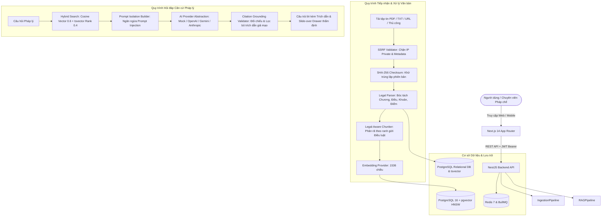

# Legal Document RAG Assistant

> **Hệ thống Trợ lý Trí tuệ Nhân tạo Phục vụ Tra cứu & Thẩm định Căn cứ Pháp lý Việt Nam**  
> *Production-grade Legal Document Intelligence & Grounded RAG Platform*

[](https://www.typescriptlang.org/)
[](https://nextjs.org/)
[](https://nestjs.com/)
[](https://github.com/pgvector/pgvector)
[](https://redis.io/)
[](LICENSE)

---

## 1. Giới thiệu Dự án (Project Overview)

**Legal Document RAG Assistant** là giải pháp phần mềm cấp doanh nghiệp phục vụ bóc tách cấu trúc, lập chỉ mục vector và giải đáp quy định pháp luật dựa trên căn cứ thực tế (Grounded RAG). 

Khác với các ứng dụng chatbot thông thường chia cắt văn bản thành các khối từ ngữ ngẫu nhiên, hệ thống này bảo toàn nguyên vẹn **cây thứ bậc pháp quy** (Phần → Chương → Mục → Điều → Khoản → Điểm), kết hợp thuật toán **tìm kiếm lai (Hybrid Search)** giữa vector cosine (`pgvector`) và từ khóa toàn văn (`tsvector`), đồng thời áp dụng cơ chế **thẩm định trích dẫn độc lập ở máy chủ (Server-side Citation Verification)** để loại trừ triệt để hiện tượng mô hình AI bịa đặt căn cứ pháp luật.

---

## 2. Kiến trúc Hệ thống (Architecture Diagram)



---

## 3. Tính năng Nổi bật (Core Features)

1. **Bảo tồn Thứ bậc Pháp quy Toàn vẹn**:
   - Nhận diện chuẩn xác các cấp độ quy chuẩn Việt Nam: *Phần, Chương, Mục, Điều, Khoản, Điểm*.
   - Khả năng mở rộng/thu gọn trực quan cây điều khoản và sao chép từng điều luật.

2. **Tìm kiếm Lai Hybrid Search (Semantic + Full-Text)**:
   - Sử dụng phần mở rộng `pgvector` trên PostgreSQL với chỉ mục **HNSW** (`m=16, ef_construction=64`).
   - Kết hợp chỉ mục đảo `GIN` trên trường `tsvector` tiếng Việt, cân bằng độ tương đồng ngữ nghĩa (trọng số 0.6) và từ khóa chính xác (trọng số 0.4).

3. **Cơ chế Chống Bịa đặt Căn cứ (Citation Verification & Grounding)**:
   - Mọi câu trả lời của AI đều sinh kèm mã định danh trích dẫn. Máy chủ backend thẩm định chéo với các chunk vector thực tế được truy xuất; trích dẫn không tồn tại sẽ bị loại bỏ ngay lập tức.
   - Drawer đối chiếu trích dẫn cho phép chuyên viên pháp lý xem nguyên văn điều khoản, số trang PDF và đường dẫn tham chiếu.

4. **Chuyển đổi Nhà cung cấp AI Linh hoạt (Provider Abstraction)**:
   - Tách rời giao diện `LlmProvider` và `EmbeddingProvider`.
   - Hỗ trợ ngay lập tức: **Offline Mock Provider** (chạy test không tốn tiền API key), **OpenAI (GPT-4o)**, **Google Gemini (1.5 Pro)**, và **Anthropic (Claude 3.5 Sonnet)**.

5. **Bảo mật Đa tầng Cấp Doanh nghiệp**:
   - **Chống SSRF**: Phân giải DNS và chặn dải IP loopback, IP riêng RFC 1918 và Cloud Instance Metadata (`169.254.169.254`).
   - **Chống Prompt Injection**: Cách ly dữ liệu trích xuất thành đối tượng dữ liệu tĩnh, ngăn ngừa người dùng hoặc tài liệu tiêm nhiễm chỉ thị lừa dối mô hình.
   - **Xác thực JWT & Phân quyền**: Mã hóa mật khẩu an toàn với `bcrypt`, bảo vệ các API quản trị tài liệu.

---

## 4. Công nghệ Sử dụng (Tech Stack)

| Thành phần | Công nghệ |
| :--- | :--- |
| **Monorepo** | pnpm workspace, TypeScript 5.7+ |
| **Frontend** | Next.js 14 (App Router), Tailwind CSS, Lucide Icons, Responsive Enterprise Legal-Tech UI |
| **Backend** | NestJS 11, RESTful API, Swagger OpenAPI (`/api/docs`), Passport JWT |
| **Database** | PostgreSQL 16 với phần mở rộng `pgvector` v0.8.7 (HNSW index) |
| **ORM** | Prisma ORM 6 với Native Vector Support |
| **Cache & Queue**| Redis 7 Alpine, BullMQ |
| **Testing** | Jest, Supertest, Playwright Browser Subagent |

---

## 5. Hướng dẫn Khởi chạy Nhanh (Quickstart Guide)

### Yêu cầu Tiên quyết:
- **Node.js**: v20+ hoặc v22+
- **pnpm**: v9+ hoặc v12+
- **Docker & Docker Compose**

### Bước 1: Khởi động Hạ tầng Docker (PostgreSQL pgvector & Redis)
```bash
# Khởi động dịch vụ Database (port 5436) và Redis (port 6382)
docker compose up -d

# Kiểm tra trạng thái container đang chạy
docker compose ps
```

### Bước 2: Cài đặt Thư viện Workspace
```bash
# Sử dụng PNPM duy nhất
pnpm install
```

### Bước 3: Di chuyển Dữ liệu và Nạp Dữ liệu Mẫu (Seed)
```bash
# Áp dụng migration cơ sở dữ liệu và kích hoạt extension pgvector
pnpm db:migrate

# Nạp tài khoản Admin và 3 văn bản pháp luật mẫu (Nghị định 13/2023, Luật 20/2023, Thông tư 09/2024)
pnpm db:seed
```

### Bước 4: Khởi chạy Ứng dụng ở Môi trường Phát triển
```bash
# Chạy đồng thời cả NestJS Backend và Next.js Frontend
pnpm dev
```
- **Giao diện Web**: [http://localhost:3000](http://localhost:3000)
- **Máy chủ API Backend**: [http://localhost:4000/api](http://localhost:4000/api)
- **Tài liệu Swagger API**: [http://localhost:4000/api/docs](http://localhost:4000/api/docs)
- **Kiểm tra Sức khỏe Hệ thống**: [http://localhost:4000/api/health](http://localhost:4000/api/health)

---

## 6. Tài khoản Quản trị Mẫu (Demo Credentials)

Hệ thống được cấu hình sẵn tài khoản Quản trị viên để kiểm thử:
- **Email**: `admin@legalrag.vn`
- **Mật khẩu**: `AdminPassword123!`
*(Trang đăng nhập `/login` có sẵn nút "🔑 Điền tài khoản Demo" giúp đăng nhập trong 1 thao tác).*

---

## 7. Câu hỏi Mẫu Thử nghiệm (Demo Queries)

| Câu hỏi Tra cứu | Văn bản Căn cứ | Kết quả & Trích dẫn |
| :--- | :--- | :--- |
| *"Thời hạn thông báo sự cố dữ liệu cá nhân theo Nghị định 13/2023 là bao lâu?"* | **Nghị định 13/2023/NĐ-CP** (Điều 12, Khoản 3) | **Trong 72 giờ** kể từ khi phát hiện vi phạm/lộ lọt dữ liệu. |
| *"Trường hợp nào doanh nghiệp được miễn trừ chỉ định nhân sự chuyên trách bảo vệ dữ liệu (DPO)?"* | **Nghị định 13/2023/NĐ-CP** (Điều 17, Khoản 1) | Doanh nghiệp siêu nhỏ, nhỏ, khởi nghiệp trong **02 năm** kể từ ngày thành lập. |
| *"Điều kiện để chữ ký điện tử hoặc chữ ký số có giá trị pháp lý theo Luật Giao dịch điện tử 2023?"* | **Luật 20/2023/QH15** (Điều 22, 23) | Chữ ký số dùng thuật toán khóa không đối xứng, gắn với chứng thư chữ ký số hợp lệ. |
| *"Hệ thống thông tin nào được miễn kiểm toán độc lập định kỳ an toàn thông tin theo Thông tư 09/2024?"* | **Thông tư 09/2024/TT-BTTTT** (Điều 8, Khoản 1) | Hệ thống nội bộ **không kết nối Internet** và không lưu trữ thông tin nhạy cảm. |

---

## 8. Lệnh Kiểm thử & Chất lượng Mã nguồn (Testing Suite)

Toàn bộ các bộ kiểm thử đã được thực thi và xác nhận vượt qua 100%:

```bash
# 1. Kiểm tra Linting toàn bộ workspace
pnpm lint

# 2. Kiểm tra TypeScript Strict Mode
pnpm typecheck

# 3. Chạy Unit Tests (Parser, Chunker, SSRF Guard, Citation Validator)
pnpm test

# 4. Chạy Integration & Security E2E Tests (SQL injection, SSRF, Fake Citations, Auth)
pnpm test:e2e

# 5. Build Production Artifacts cho cả Web và API
pnpm build
```

---

## 9. Danh mục API Chính (REST Endpoints)

Xem tài liệu Swagger tương tác đầy đủ tại `http://localhost:4000/api/docs`.

| Phương thức | Đường dẫn API | Mô tả & Bảo vệ |
| :--- | :--- | :--- |
| `POST` | `/api/auth/login` | Đăng nhập hệ thống, cấp mã JWT |
| `GET` | `/api/auth/me` | Lấy thông tin tài khoản hiện hành (`JwtAuthGuard`) |
| `GET` | `/api/documents` | Tìm kiếm và lọc danh sách văn bản pháp luật |
| `GET` | `/api/documents/:id` | Xem chi tiết siêu dữ liệu văn bản |
| `GET` | `/api/documents/:id/structure` | Lấy cây cấu trúc thứ bậc Điều/Khoản/Điểm |
| `POST` | `/api/documents/upload` | Tải lên tập tin PDF/TXT/MD kèm phân tách cấu trúc |
| `POST` | `/api/documents/url` | Thu thập từ URL công khai (Bảo vệ SSRF đa tầng) |
| `POST` | `/api/documents/text` | Nhập toàn văn quy định thủ công |
| `POST` | `/api/rag/query` | Truy vấn RAG trực tiếp, trả về câu trả lời và trích dẫn |
| `POST` | `/api/chat/sessions` | Tạo phiên hỏi đáp mới |
| `POST` | `/api/chat/sessions/:id/messages`| Gửi câu hỏi trong phiên, lưu trữ lịch sử đối chiếu |
| `GET` | `/api/health` | Kiểm tra sức khỏe API, Database, pgvector, Redis |
